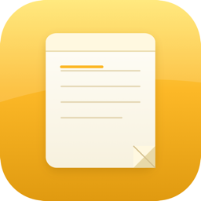

<p align="center">
  
</p>

<h1 align="center">Notes</h1>

<p align="center">
  <strong>A calm, offline notes app inspired by Apple Notes.</strong><br />
  Three columns. Yellow folders. Write and it just stays.
</p>

<p align="center">
  
  
  
</p>

---

## Features

- Folders, tags (`#tag`), pin & lock
- Checklists, tables, images, rich text
- Search, sort, list / gallery views
- Trash with recover
- Works in the **browser** or as a **Mac app**
- Data stays on your machine (localStorage / Electron userData)

## Quick start

```bash
git clone https://github.com/diogopaulino/notes.git
cd notes
npm install
```

### Browser

```bash
npm run dev
```

Open [http://127.0.0.1:5173](http://127.0.0.1:5173)

### Desktop (Mac)

```bash
npm run desktop
```

### Installable DMG

```bash
npm run pack
```

Find the installer in `release/Notes-*.dmg`  
First open: right-click → **Open** (unsigned build).

## Shortcuts

| Key | Action |
|-----|--------|
| `⌘ N` | New note |
| `⌘ F` | Focus search |

## Project layout

```
notes/
├── electron/          # Desktop shell
├── src/               # React UI
├── build/icon.icns    # App icon
└── docs/icon.png      # README icon
```

## For contributors

1. Fork & clone  
2. `npm install` → `npm run desktop`  
3. Open a PR with a short “why”

MIT licensed — use it, fork it, ship your own build.

## License

[MIT](LICENSE) — free for personal and commercial use.
